# yuleASR Bootloader 设计文档

> **文档版本**: v1.0
> **适用平台**: NXP S32K312 (Cortex-M7/M33) + HSM
> **密码学基线**: ECDSA P-256 + SHA-256 (HSM 优先, 软件兜底)
> **合规目标**: UNECE R156 (SUMS) / GB 44496-2024 / ISO-SAE 21434 / ASIL-D
> **代码位置**: `src/bsw/boot/` (启动静态库) + `src/bootloader/` (OTA 服务层) + `include/autosar/bl_rollback_storage.h` (跨层接口)

---

## 1. 概述

### 1.1 设计目标

yuleASR Bootloader 提供量产级的安全启动 (Secure Boot) 与无感知 OTA 固件更新能力:

1. **信任链启动** — BootROM(HSM) → PBL → SBL → Application 逐级验签, 不可绕过。
2. **A/B 双槽 OTA** — 只写非活动槽, 更新失败自动回滚, 车辆永不变砖。
3. **防回滚攻击** — 单调递增抗回滚计数器 (NVM 持久化, 磨损均衡), 拒绝降级固件。
4. **法规对齐** — 用户确认 (GB 44496-2024 §6.3)、升级审计日志 (§7.2 / R156 §7.1.1)、掉电保护、业务健康门控。
5. **可移植** — 平台相关代码收敛于 Flash/HSM 适配层, 验证逻辑纯软件复用。

### 1.2 范围与代码组成

| 层次 | 目录 | 职责 |
|:-----|:-----|:-----|
| 启动静态库 (PBL/SBL 共用) | [src/bsw/boot](file:///workspace/src/bsw/boot) | Boot_Loader / Boot_Update / Boot_Image / Boot_Verify / Boot_Flash / Boot_Hsm |
| OTA 服务层 | [src/bootloader](file:///workspace/src/bootloader) | bl_partition / bl_secure_boot / bl_rollback / bl_antrollback / bl_upgrade_log / bl_time |
| SBL 集成层 | [src/bootloader/main](file:///workspace/src/bootloader/main) | sbl_main — 串起 NVM 计数器 → 验签 → 启动/回滚完整链路 |
| 跨层接口 | [include/autosar/bl_rollback_storage.h](file:///workspace/include/autosar/bl_rollback_storage.h) | 抗回滚存储服务接口 (依赖注入, 分层解耦) |
| 启动硬件初始化 CDD | [src/bsw/cdd](file:///workspace/src/bsw/cdd) | Cdd_Boot — HSM 早起初始化 / 复位原因 / 时钟校验 / FCCU 预初始化 |

### 1.3 需求追溯标记

代码中 `@req SHALL_BOOT` 统一标注启动需求; RS-OTA-xx 系列需求与法规条款的映射见 §13。

---

## 2. 系统架构

### 2.1 信任链模型

```
BootROM (HSM ROM, 芯片出厂固化)
  │  HSM 硬件验证 PBL 签名 (不可绕过)
  ▼
PBL — Primary Bootloader (~4KB, 不可更新)
  │  Reset_Handler → 最小初始化 → 验证 SBL → 跳转
  ▼
SBL — Secondary Bootloader (~64KB, 可经 UDS 更新)
  │  OS/外设初始化 → 验证 Application (A/B 槽选择) → 跳转
  ▼
Application (yuleASR BSW + ASW)
  │  运行时完整性校验 (WdgM/Safety 周期 CRC)
  ▼
Runtime Monitoring (Crypto Watchdog + 安全监控)
```

**Mermaid 架构图:**

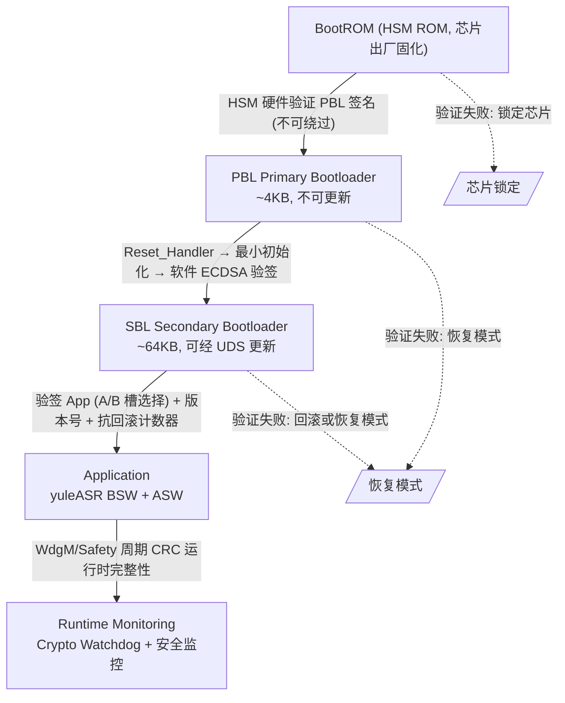

**每级验证责任:**

| 阶段 | 验证内容 | 验证方式 | 失败处理 |
|:-----|:---------|:---------|:---------|
| BootROM → PBL | PBL 签名 | HSM 内置公钥 (熔丝) | 锁定芯片 |
| PBL → SBL | SBL 签名 + 版本号 | 软件 ECDSA (PBL 内置 SBL 公钥) | 进入恢复模式 |
| SBL → App | App 签名 + 版本号 + 抗回滚计数器 | 软件 ECDSA (SBL 内置 App 公钥) | 回滚或恢复模式 |
| Runtime | 关键段 CRC | WdgM 周期性校验 | 安全复位 |

### 2.2 软件分层与依赖

```
┌────────────────────────────────────────────────────────────┐
│ sbl_main (集成层)                                           │
│  依赖注入: flash 驱动 / CSM-KeyM / App 镜像 / 跳转回调      │
└──────────┬──────────────────────────────┬──────────────────┘
           │                              │
┌──────────▼──────────────┐   ┌───────────▼──────────────────┐
│ bootloader OTA 服务层    │   │ bsw/boot 启动静态库           │
│  bl_antrollback (NVM)   │◀──│  Boot_Update                  │
│  bl_secure_boot (验签)  │   │  Boot_Loader                  │
│  bl_rollback (回滚)     │   │  Boot_Image / Boot_Verify     │
│  bl_partition (A/B 分区)│   │  Boot_Flash / Boot_Hsm (HAL)  │
│  bl_upgrade_log (审计)  │   └───────────┬──────────────────┘
│  bl_time (时间源抽象)   │               │
└──────────┬──────────────┘   ┌───────────▼──────────────────┐
           │                  │ MCAL Flash / HSM HAL /        │
           └─────────────────▶│ CSM / KeyM (crypto_stack)     │
                              └──────────────────────────────┘
```

**Mermaid 架构图:**

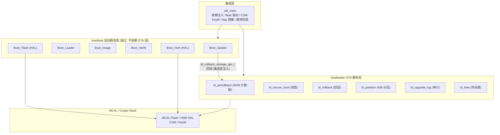

**分层解耦关键设计 (方案 C 依赖注入):**

- `bsw/boot` 是独立静态库, **不编译期依赖** bootloader 层 (交叉构建时 bootloader 层整体排除)。
- 抗回滚计数器的**单一事实源**是 `bl_antrollback` 的 NVM 存储; `Boot_Update` 通过 `bl_rollback_storage_api_t` 函数表回调访问, 由集成层 `sbl_main_connect_antrollback()` 在启动时注入。
- 未注入时 `Boot_Update` 回落到旧 BIB 自带 pending 机制 (向后兼容既有测试与老集成)。
- BIB 在注入模式下只做版本管理 (sbl_version/app_version/status/boot_count), 不再重复存计数器。

---

## 3. Flash 内存布局

### 3.1 整体布局 (S32K312, 2MB Flash)

布局常量由 yuleASR-Configurator 生成, 见 [Boot_Cfg.h](file:///workspace/src/bsw/boot/include/Boot_Cfg.h):

| 区域 | 起始地址 | 大小 | 说明 |
|:-----|:---------|:-----|:-----|
| PBL | `0x0000_0000` | 4 KB | Primary Bootloader (含向量表), 不可更新 |
| [预留] | `0x0000_1000` | 4 KB | — |
| SBL | `0x0000_2000` | 64 KB | Secondary Bootloader (Header + Payload + Trailer) |
| App Slot A | `0x0001_2000` | 952 KB | 应用槽 A (Header + Payload + Sig) |
| App Slot B | `0x0010_0000` | 896 KB | 应用槽 B (OTA 目标槽) |
| BIB | `0x001E_0000` | 64 KB | Boot Info Block (启动/升级状态) |
| NVM / EEPROM 模拟 | `0x001F_0000` | 32 KB | 抗回滚计数器槽位 / 升级日志等 |

**Mermaid 布局图:**

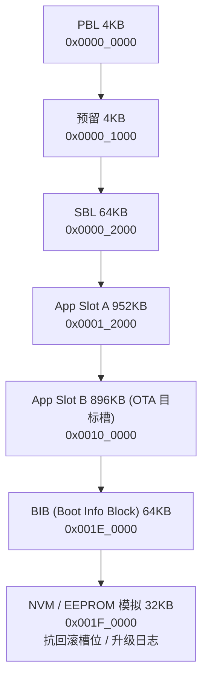

### 3.2 PBL 链接布局

PBL 使用专用链接脚本 [Boot_Linker.ld](file:///workspace/src/bsw/boot/config/Boot_Linker.ld):

- `flash_pbl` 1KB + `flash_vector` 256B (向量表) + `flash_pbl_ro` 2.75KB (代码/只读数据/`.boot_pubkey` 公钥段)
- `ram_pbl` 4KB 安全 RAM, 1KB 栈
- `ram_handshake` 32B @ `0x2000FFE0`: App↔Bootloader 握手块, 导出 `__boot_handshake_start`/`__boot_handshake_end`, ORIGIN 与 `s32k312.ld` 保持一致 (详见 §5.5 "链接脚本单点定义")
- 公钥经 `KEEP(*(.boot_pubkey))` 固定在只读段, 随 PBL 一同被 BootROM 验签保护

---

## 4. 关键数据结构

### 4.1 固件映像格式 (bsw/boot 层)

**Image Header (64 字节)** — 见 [Boot_Types.h](file:///workspace/src/bsw/boot/include/Boot_Types.h):

```c
typedef struct {
    uint32_t magic;          // 'YBL1' = 0x314C4259
    uint32_t header_crc;     // 头校验
    uint32_t image_type;     // 0x01=PBL, 0x02=SBL, 0x03=App
    uint32_t version;        // 版本号 (防回滚基准)
    uint32_t payload_size;   // 有效载荷字节数
    uint8_t  hash[32];       // SHA-256(payload)
    uint8_t  reserved[12];
} Boot_ImageHeader;
```

**Image Trailer (128 字节):**

```c
typedef struct {
    uint8_t  signature[64];  // ECDSA P-256 签名
    uint32_t signature_algo; // 0x01=ECDSA_P256
    uint32_t signing_time;   // 签名时间戳 (可选)
    uint8_t  reserved[56];
} Boot_ImageTrailer;
```

### 4.2 Boot Info Block (BIB, 68 字节)

BIB 是启动决策与升级状态的核心持久化结构 (magic `'BIB0'` = `0x30424942`):

| 字段 | 语义 |
|:-----|:-----|
| `pbl_version / sbl_version / app_version` | 各级固件版本 |
| `boot_count` | 连续未确认启动次数; 正常确认后清零 |
| `max_boot_attempts` | 默认 5, 超限进入恢复模式 |
| `status` | bit1 (0x02) = 槽位选择 (0=A, 1=B); 0x01=正常; 0xFF=永久恢复 |
| `anti_rollback_counter` | 已确认抗回滚地板 (旧模式; 注入模式下由 bl_antrollback NVM 接管) |
| `pending_counter / pending_boot_count` | 待确认版本 / 已成功启动次数 (延后递增) |
| `update_state` | 掉电保护状态机: IDLE(0) / DOWNLOADING(1) / PENDING(2) |
| `crc32` | 结构校验 (偏移 64) |

**兼容性设计 (编译期固化):** `sizeof(Boot_InfoBlock)==68`、`crc32` 偏移 64、`update_state` 偏移 40 由 `_Static_assert` 锁定 — 旧 BIB 的 CRC 仍可校验, 旧 reserved 字节读为 pending 时由 `bib_pending_valid()` 拦截 (DOWNLOADING 态/pending≤地板/次数越界均判无效)。结构变更若破坏这些偏移, **编译期直接报错**而非运行时静默破坏。

### 4.3 抗回滚槽位记录 (bl_antrollback, v3)

计数器持久化于独立 NVM 区, 多槽位磨损均衡 (默认 4 槽, 上限 8 槽, 每槽一扇区):

```c
typedef struct {
    uint32_t magic;              // 'ARBC' = 0x41524243
    uint32_t record_version;     // 3 (v2 记录兼容读)
    uint32_t counter;            // 已确认抗回滚计数器 (地板)
    uint32_t write_seq;          // 全局写入序号 (最新判定/磨损均衡)
    uint32_t pending_counter;    // 待确认版本 (0=无)
    uint32_t pending_boot_count; // 新版本成功启动次数
    uint32_t health_confirmed;   // v3: 业务健康确认标记
    uint32_t crc32;              // 前 7 字段 CRC32 (v2 为前 6 字段)
} bl_antrollback_slot_t;
```

- 初始化扫描全部槽位, 以最大 `write_seq` (次为 counter) 的合法记录恢复; 全部无效从 0 开始。
- 写入轮转到下一槽位: 擦除 → 编程 → 读回校验; 值低于当前值 → `DECREMENT_ATTEMPT` (防回滚攻击), 等于允许幂等重写。
- 生产集成要求: `base_address` 按 Flash 扇区对齐, NVM 区 ≥ `slots × 扇区大小`。

### 4.4 升级日志条目 (bl_upgrade_log)

环形缓冲 (默认 16 条, Configurator 可裁剪), 满则覆盖最旧; 每条独立 CRC32; 头部 (magic `'ULOG'`) 持久化容量/计数/队首索引。

```c
typedef struct {
    uint64_t timestamp_ms;     // 经 bl_time 获取; 无时间源必须显式报错
    uint32_t version;          // 固件版本号
    uint8_t  source;           // OTA / 诊断仪 / 本地烧录
    uint8_t  signature_result; // 验签通过 / 失败 / 未验签
    uint8_t  result;           // 成功 / 失败 / 中止 / 回滚 / 超时
    uint8_t  reserved[7];
    uint32_t crc32;
} bl_upgrade_log_entry_t;
```

---

## 5. 启动流程设计 (Boot_Loader)

### 5.1 主流程 (Boot_Loader_Main)

```
① 最小硬件初始化 (Boot_Flash_Init)
② 加载 BIB → 无效 (首次启动/损坏) 则重建默认值
③ 解析启动目标 (Boot_Loader_ResolveBootTarget)
   ├─ BIB.status bit1 = 0 → 目标 = SBL (SBL 再验 App 槽 A)
   └─ BIB.status bit1 = 1 → 目标 = App Slot B
④ 验签目标映像
   ├─ 读 Image Header → 校验 magic/header_crc/type
   ├─ 增量 SHA-256: 4KB 页缓冲逐块读 flash 哈希 payload
   ├─ 读 Image Trailer
   └─ 验签: HSM 优先 (Boot_Hsm_VerifySignature), 失败回落软件 ECDSA
      (Boot_Verify_Signature, mbedtls; 密钥按目标选 SBL/App 公钥)
⑤ 验签通过 → BIB.boot_count=0, status=0x01, 落盘
⑥ 跳转 (Boot_Loader_Jump)
失败路径 → boot_count++; ≥ max_boot_attempts(5) → status=0xFF 永久恢复;
           否则保存 BIB 后进入恢复模式
```

**Mermaid 流程图:**

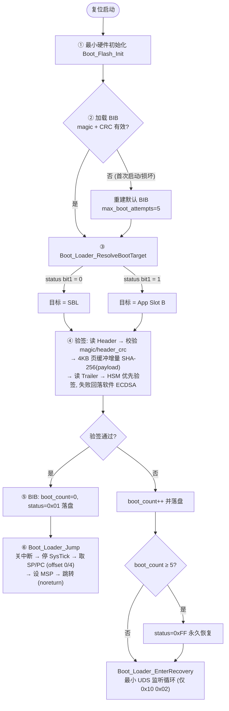

### 5.2 跳转实现 (Boot_Loader_Jump)

1. 关中断 (`cpsid i`, 宿主构建为空操作)
2. 停 SysTick, 清挂起中断 (`SCB->ICSR` bit25)
3. 从目标向量表取初值: `SP = *(target+0)`, `PC = *(target+4)`
4. 设置 MSP/PSP, 跳转 App 入口 (noreturn)

### 5.3 恢复模式 (Boot_Loader_EnterRecovery)

最小 UDS 监听循环 — 仅接受 `0x10 0x02` (Programming Session); 生产实现初始化 CAN/DoIP 进入诊断刷写循环, 周期喂狗。

### 5.4 掉电保护 (RS-OTA-06)

`update_state` 三态与升级写入的关键节点绑定:

| 节点 | 动作 | 语义 |
|:-----|:-----|:-----|
| ① Prepare 擦除前 | 落盘 DOWNLOADING | 擦除/写入中途掉电 → 重启识别未完成升级 |
| ② Finalize 校验通过 | 落盘 PENDING | 进入候选槽验证/确认阶段 |
| ③ 升级全部完成 | 落盘 IDLE | 终态, 无残留 |

**回退策略:** OTA 只写非活动槽 (Prepare 防护性拒绝写活动槽), 故 DOWNLOADING 掉电后活动槽必然完好 → 启动决策按 marker 正常执行即自然回退到完好的活动槽, 旧固件照常运行。不强制回退 Slot A (marker=1 时活动槽是 B, 强制回退 A 反而指向正在被擦写的目标槽, 会击穿保护)。旧 BIB 无此字段读为 IDLE, 行为不变, 天然兼容。

**Mermaid 状态机:**

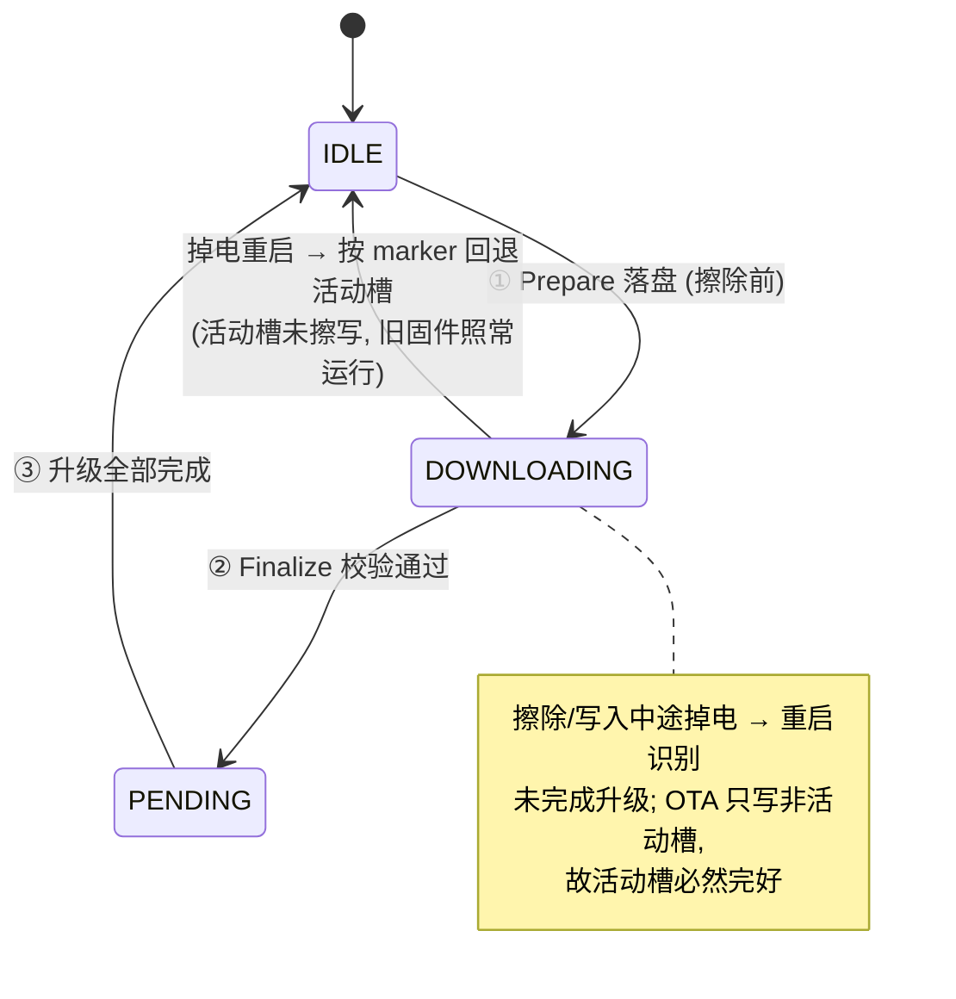

### 5.5 App ↔ Bootloader 握手协议 (跨复位 BootTarget 传递)

**问题背景:** `EcuM_SelectBootTarget(OEM_BOOTLOADER)` 原仅设置 App 内部 RAM 变量, 复位即丢失, SBL 无法感知"进入下载模式"请求。本节补齐双向握手。

**实现层级:**

```
App 侧 (EcuM)                         SBL 侧 (bsw/boot)
EcuM_SelectBootTarget()               Boot_Loader_Main() Phase 0
  → EcuM_BootTarget (RAM)               → Boot_Handshake_GetTarget()
                                        → OEM/SYS → Clear + EnterRecovery
EcuM_PerformReset()                   Boot_Handshake 模块
  → Boot_Handshake_WritePersist()      (共享布局头 Boot_Handshake.h)
  → EcuM_AL_Reset() ──复位──►
```

**握手块布局** (32 字节; 地址由链接脚本 `ram_handshake` 区单点定义, 当前 `0x2000_FFE0`, S32K312 Safe RAM 顶部保留区; C 侧经链接符号 `__boot_handshake_start` 访问, 无硬编码):

| 字段 | 大小 | 说明 |
|:-----|:-----|:-----|
| magic | 4B | `0x48534842` ('BHSH') |
| target | 4B | 0=OEM Bootloader / 1=SYS Bootloader / 2=Application |
| target_inv | 4B | `~target`, 完整性校验 (无需 CRC) |
| version | 4B | `0x00010000` (v1.0) |
| reserved | 16B | 预留对齐 |

**选位约束 (为何放在 0x2000FFE0):**

```
S32K312 512KB SRAM 布局:
  0x20000000 ┌──────────────────────┐
             │ ram_safe (64KB-32B)  │  ECC 保护, .safety/.ecc data+bss
  0x2000FFE0 ├──────────────────────┤  ← 握手块 (32B, NOLOAD, 跨复位保持)
  0x20010000 ├──────────────────────┤
             │ ram_general (384KB)   │  .data/.bss/.os_bss/.heap
  0x20070000 ├──────────────────────┤
             │ ram_shared (64KB)     │  共享/DMA
  0x20080000 └──────────────────────┘  ← STACK_TOP, 栈向下增长 (128KB)
                                          栈区: 0x20060000 ~ 0x20080000
```

地址 `0x2000FFE0` 必须同时避开:
1. **栈区** `0x20060000-0x20080000`（栈自顶向下增长，首条调用即触及顶部字节）；
2. **BSS 清零范围**：S32K312 启动代码仅清零 `__bss_start`~`__bss_end`（ram_general 中的 `.bss`），握手块位于独立 `ram_handshake` 区 + `.boot_handshake (NOLOAD)` 段，不被清零；
3. **PBL RAM** `0x20000000-0x20000FFF`（PBL 仅 4KB，握手块在 64KB 偏移处，不被 PBL 启动清零）。

> **修正记录:** 初版选 `0x2007FFE0` (SRAM_U 顶部)，但该地址落在栈区内，会被 App 栈覆盖。已修正为 `0x2000FFE0`。

**链接脚本单点定义 (改造细节):**

握手块地址经历"绝对地址硬编码 → 链接符号"两阶段改造，动机与机制如下。

*改造前（双硬编码问题）:* C 头文件宏 `BOOT_HANDSHAKE_ADDR 0x2000FFE0` 与链接脚本 `ram_handshake ORIGIN = 0x2000FFE0` 是**两处独立硬编码**，无任何编译期/链接期关联校验；改一处漏一处时，C 代码会静默读写错误地址（不报错、不警告，运行时才发现握手失效或踩内存）。

*改造后（链接符号方案）:* 地址只在链接脚本中出现一次，C 代码经链接器导出符号访问：

```
链接脚本 (单一事实源)                        C 代码 (Boot_Handshake.h)
ram_handshake (rw): ORIGIN = 0x2000FFE0      extern const Boot_HandshakeBlock_t __boot_handshake_start;
.boot_handshake (NOLOAD) : {                 #define BOOT_HANDSHAKE_PTR()  (&__boot_handshake_start)
    __boot_handshake_start = ABSOLUTE(.);
    . = . + 0x20;
    __boot_handshake_end = ABSOLUTE(.);
} > ram_handshake
ASSERT(end - start == 0x20)   ← 链接期强校验
```

| 机制 | 说明 |
|:-----|:-----|
| 符号导出 | 两个链接脚本各自在 `.boot_handshake` 段导出 `__boot_handshake_start`/`__boot_handshake_end`;C 侧 `extern` 声明后取地址即物理地址（GNU ld 绝对符号惯例） |
| 双脚本一致性契约 | App/SBL 用 `s32k312.ld`,PBL 用 `Boot_Linker.ld`,**两处 `ram_handshake` 的 ORIGIN 必须一致**——它们是各自独立链接的镜像，运行时共享同一物理 SRAM；契约靠注释 + 两侧 `ASSERT(区大小==0x20)` 保证 |
| 链接期 fail-loud | 符号未定义 → 链接直接报错（优于硬编码方案的静默写错地址）;`ASSERT` 防止区域被意外改小 |
| 平台自动判定 | `BOOT_HANDSHAKE_USE_LD_SYMBOL`: `__arm__/__thumb__` (Cortex-M) 自动 =1 走链接符号，其他（x86/aarch64 宿主）自动 =0 回退进程内静态变量；可 `-D` 显式覆盖 |
| Host 单测 | 无真实复位/链接脚本，静态变量模拟，全部单测不受影响 |
| 附带修复 | 旧代码 `__aarch64__` 宿主（如 Apple Silicon CI）会误走绝对地址写穿内存；新判定仅认 Cortex-M，aarch64 宿主安全回退 |

*移植/调布局流程*（验证灵活性）: 换地址只改两个 `.ld` 的 `ram_handshake ORIGIN` → 重新链接各镜像 → 完成。C 代码零改动。如需掉电保持，将 `ram_handshake` 改指 Sticky/Backup 寄存器地址即可。

**完整性:** `magic 正确 && version 正确 && target ^ target_inv == 0xFFFFFFFF`。轻量零依赖, App 侧 EcuM 无需引入 CRC 库。

**Mermaid 时序图:**

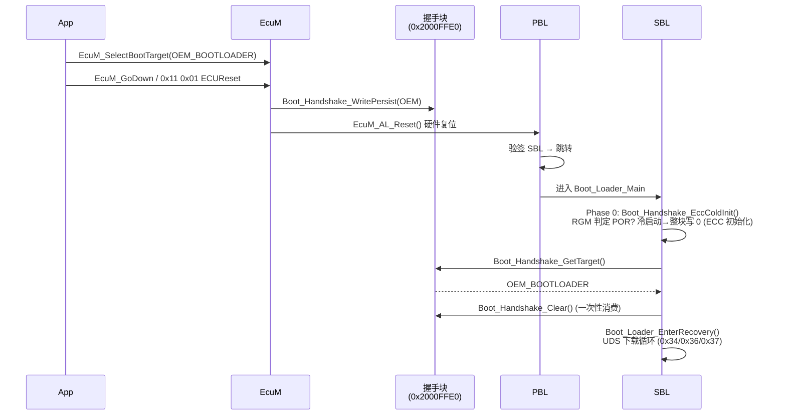

**关键设计点:**

1. **跨层共享布局头** `include/autosar/Boot_Handshake.h` — 仅含数据结构与内联辅助 (`WritePersist/ReadPersist/ClearPersist`), App 与 SBL 各自包含, **App 不依赖 bsw/boot 静态库**。
2. **一次性消费**: SBL 读取后立即 `Boot_Handshake_Clear()`, 避免残留导致后续上电误进入下载模式。
3. **默认安全**: 握手块无效/非法 target → 返回 `APPLICATION`, 正常启动 App (fail-open for boot, 不阻断正常启动)。
4. **地址单一事实源在链接脚本**: C 代码不硬编码地址; Cortex-M 镜像经链接脚本导出符号 `__boot_handshake_start` 定位握手块 (`s32k312.ld` 与 `Boot_Linker.ld` 的 `ram_handshake` 区 ORIGIN 必须一致, 两处均带 `ASSERT` 校验 32B)。调整布局只改链接脚本; Host 构建经 `BOOT_HANDSHAKE_USE_LD_SYMBOL=0` 回退静态变量。如需掉电保持, 可将 `ram_handshake` 改指 Sticky/Backup 寄存器地址。
5. **ECC 冷启动安全 (已实现)**: S32K312 SRAM 带 ECC, POR (掉电) 后校验位未初始化, 直接读会触发不可纠正 ECC 错误 (HardFault)。`Boot_Loader_Main` Phase 0 在读握手块前先调 `Boot_Handshake_EccColdInit()`:
   - 判定: 读 `MC_RGM` (`0x40080000`) — `DES==0 && FES==0` → POR (与 `Cdd_Boot` 寄存器地图一致; 软件/外部复位在 FES 留标志, 看门狗等在 DES 留标志, 功能性/破坏性复位不清 SRAM, 仅 POR 使 SRAM+ECC 失效);
   - 冷启动 → 整块写 0 (**写操作生成 ECC 校验位**), 同时天然清除残留握手; 热复位 → 跳过, 握手内容保留;
   - `Boot_Handshake_IsColdStart()` 为**弱符号**, 单测可覆写注入 POR 场景; 只读 RGM 不清标志 (PBL 与 SBL 需看到同一状态)。
6. **Host 单测兼容**: 非 ARM 构建下 `BOOT_HANDSHAKE_PTR()` 映射到进程内静态变量, 单测 `test_boot_handshake.c` 覆盖 Set/Get/Clear/非法值/完整性校验/冷启动 ECC 初始化 (弱符号注入)。

**代码落点:**
- 共享头: [Boot_Handshake.h](file:///workspace/include/autosar/Boot_Handshake.h)
- SBL 模块: [Boot_Handshake.c](file:///workspace/src/bsw/boot/src/Boot_Handshake.c) / [Boot_Handshake.h](file:///workspace/src/bsw/boot/include/Boot_Handshake.h)
- SBL 消费点: [Boot_Loader.c#L34-L46](file:///workspace/src/bsw/boot/src/Boot_Loader.c#L34-L46) (Phase 0)
- App 写入点: [EcuM.c#L837-L850](file:///workspace/src/bsw/services/ecum/src/EcuM.c#L837-L850) (`EcuM_PerformReset`)

---

## 6. 安全机制设计

### 6.1 验签三板斧 (RS-OTA-04, bl_secure_boot_verify_strict)

严格按 **①签名 → ②版本绑定 → ③完整性** 顺序执行, 任一失败即拒绝 (调用方写升级日志):

1. **版本绑定签名验证** — 签名不直接覆盖 payload, 而覆盖版本绑定结构 (44 字节定长, AUTOSAR 风格无隐式填充):

   ```c
   typedef struct {
       uint32_t format_version;    // = 1 (防混淆)
       uint32_t firmware_version;  // 签名内固件版本号
       uint32_t firmware_size;     // payload 大小 (防长度混淆)
       uint8_t  payload_hash[32];  // payload SHA-256
   } bl_version_binding_t;
   ```
   攻击者篡改头部 `firmware_version` 后, 验签结构随之改变 → 步骤①即失败。

2. **版本绑定校验** — 签名内版本 == 头部版本 (防版本号篡改); 头部版本 < 抗回滚计数器 → `ROLLBACK_PROTECTION`; 再执行与 current_version 的回滚比较。

3. **完整性哈希校验** — 实际 payload 哈希 == 头部声明哈希 (防篡改/损坏)。

### 6.2 算法支持与防降级

| 算法族 | 取值 | 状态 |
|:-------|:-----|:-----|
| ECDSA P-256 + SHA-256 | 默认 | ✅ 实装 (mbedtls / HSM) |
| ECDSA P-384 + SHA-384 | 可选 | ✅ 枚举就绪 |
| RSA PKCS1/PSS + SHA-256 | 可选 | ✅ 枚举就绪 |
| ED25519 | 可选 | ✅ 枚举就绪 |
| SM2 + SM3 (国密) | 预留 | ⚠️ **fail-closed**: 分发表显式返回 `BL_SB_ERROR_ALGO_NOT_SUPPORTED` (-19) |

**国密现状 (就绪框架):** 本仓库无 SM 后端 (mbedtls 无 SM2/SM3; S32K312 HSM/HSE 仅 AES/ECC P-256/P-384/SHA-256/RNG)。`Csm_Types.h`/`csm_core.h` 已加 SM 枚举并 fail-closed; `bl_secure_boot` 对 SM2/SM3 **不得降级**到 SHA-256/ECDSA (防算法降级攻击)。完整实装路径: 引入 GmSSL 或 SM 版 HSM 固件 → CSM 后端接入 → 移除 NOT_SUPPORTED 分支 → 端到端测试。

### 6.3 抗回滚机制 (RS-OTA-01, 延后递增)

**延后递增策略 (P1-4):** 新版本安装后**不立即**提升计数器, 待成功启动 N 次 (默认 3, `BOOT_ROLLBACK_CONFIRM_BOOTS`) 后才提交 — 平衡安全与回滚: 确认窗口内允许回滚到旧版本/同版本重装。

```
Finalize:  version <= counter → 拒绝 (BOOT_E_VERSION, fail-closed)
           version >  counter → Stage: pending=version, boot_count=0 落盘
每次启动成功: NotifySuccessfulBoot(current_version)
           current == pending → count++; count >= N → commit: counter=pending, 清 pending
           current != pending → 不计数不清除 (A/B 回退兼容, 新版本留待下次确认)
```

**Mermaid 流程图:**

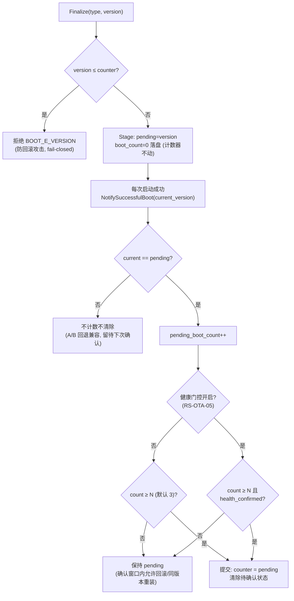

**健康门控 (RS-OTA-05 P1):** 门控开启时, 提交条件 = N 次成功启动 **且** ASW 业务健康确认 (`Boot_Update_ConfirmBusinessHealth`, 由 DCM 响应/传感器有效/无功能异常检查后调用); 未确认则 pending 保持, 本次启动计入 boot_attempt, 超限由 bl_rollback 自动回滚兜底 (不无限等待)。门控默认关闭 = 原 N 次制, 向后兼容。

### 6.4 密钥架构

| 密钥 | 存储位置 | 用途 | 更换方式 |
|:-----|:---------|:-----|:---------|
| HSM Root Key | HSM 熔丝 (软件不可读) | 验证 PBL 签名 | 芯片生命周期内不可更换 |
| PBL Public Key | HSM Key Slot 0 (OTP 烧录) | 验证 SBL 签名 | 生产时烧录 |
| SBL Public Key | PBL 固件 `.boot_pubkey` 段 | 验证 App 签名 | 随 PBL 更新 |
| App Public Key | SBL 固件 (g_boot_pubkey_app) | App 验签/运行时完整性 | 随 SBL 更新 |

HSM 密钥槽配置: PBL=0, SBL=1, APP=2 (`BOOT_HSM_KEY_SLOT_*`)。软件公钥以 DER 编码编译进 `Boot_Verify.c` (当前为占位符, 量产替换为真实密钥)。

### 6.5 证书链 (可选)

简化 X.509 证书链验证, 最大深度 4 (`BOOT_CERT_CHAIN_MAX_DEPTH`); 支持根 CA/OEM 密钥槽配置、有效期校验 (经 bl_time, 无时间源显式报错)、吊销检查接口。

### 6.6 其他安全细节

- **常量时间比较** `Boot_Verify_ConstantCmp()` — 防时序侧信道。
- **用户确认门控 (RS-OTA-02, GB 44496-2024 §6.3)** — 升级前必须用户确认; 状态机 IDLE→PENDING→GRANTED/DENIED/TIMEOUT, 30s 超时自动取消; GRANTED/DENIED/TIMEOUT 为终态防误覆盖; 确认通过前 Prepare/WriteBlock/Finalize 全部被门控拒绝。
- **写保护** — `Boot_Flash_SetProtection()` (S32K312 CSEc 硬件保护, 待驱动就绪实装)。
- **时间源抽象 (bl_time)** — 证书有效期/审计时间戳统一基准; 无已注册时间源时显式报错, 禁止以 0 时间戳充当"恒真"有效期。

---

## 7. OTA 更新流程设计

### 7.1 UDS 刷写时序 (Dcm 集成)

```
Tester                      ECU (SBL)
  │  0x10 0x02 (Programming Session) │  仅编程会话允许固件写入
  │─────────────────────────────────▶│
  │  0x27 (Security Access)          │  安全解锁
  │─────────────────────────────────▶│
  │  0x34 (RequestDownload)          │  DFID=0x01→SBL / 0x02→App 非活动槽
  │─────────────────────────────────▶│  Boot_Update_Prepare(slot, type)
  │  0x36 (TransferData) × N         │  逐块写入, 边写边增量哈希
  │═════════════════════════════════▶│  Boot_Update_WriteBlock(data, off, len)
  │  0x37 (RequestTransferExit)      │  写 header+trailer, 验证签名
  │─────────────────────────────────▶│  Boot_Update_Finalize(type, version)
  │  0x31 RID=0xFF01 (完整性检查)     │  ← 关键验证点
  │─────────────────────────────────▶│  Boot_Loader_ResolveBootTarget()
  │  0x11 0x01 (ECUReset)            │  重启 → PBL → SBL → 新槽
  │─────────────────────────────────▶│  Boot_Loader_ConfirmBoot()
```

**Mermaid 时序图:**

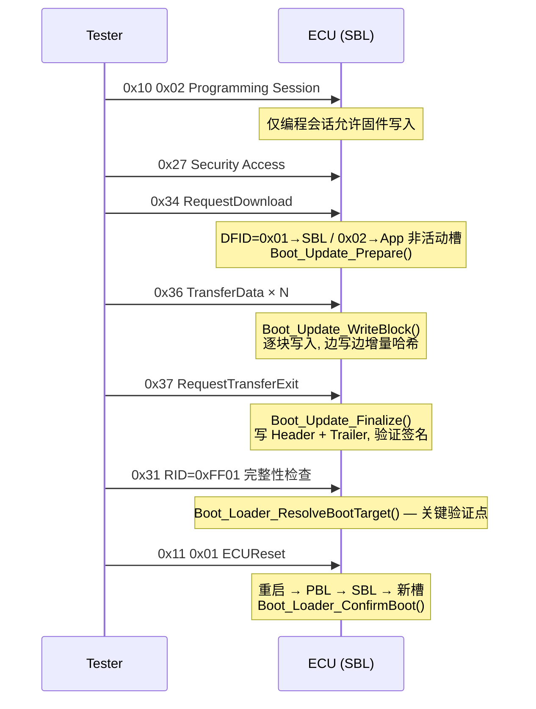

**Dcm 调用点映射** (见 [boot-dcm-integration.md](file:///workspace/docs/design/boot-dcm-integration.md)):

| UDS 服务 | Dcm 调用点 | Boot API |
|:---------|:-----------|:---------|
| 0x34 | `Dcm_Process_RequestDownload()` | `Boot_Update_Prepare()` |
| 0x36 | `Dcm_Process_TransferData()` | `Boot_Update_WriteBlock()` |
| 0x37 | `Dcm_Process_RequestTransferExit()` | `Boot_Update_Finalize()` |
| 0x31 RID=0xFF01 | `Dcm_Process_RoutineControl()` | `Boot_Loader_ResolveBootTarget()` |
| 0x11 | EcuM + WdgM | `Boot_Loader_ConfirmBoot()` |

**安全限制:** 写入期间看门狗喂狗间隔 < 100ms; 验证失败立即擦除目标槽。

### 7.2 Boot_Update 内部流程

```
RequestUserConfirm → (等待 ConfirmUserDecision, 30s 超时自动取消)
Prepare(slot, type):
  确认门控 → 拒绝写活动槽 (BIB 有效时; 出厂态放行)
  → BIB(update_state=DOWNLOADING) 落盘 → 扇区擦除 (对齐+重试×3)
WriteBlock(data, off, len):
  确认门控 → 增量 SHA-256 更新 → Flash 写入 (重试×3 + 64B 分块读回校验)
Finalize(type, version):
  确认门控 → 计算完整 payload 哈希 → 构造/写入 Image Header
  → BIB(update_state=PENDING)
  → 抗回滚: version ≤ counter 拒绝; 否则 Stage(pending=version)  [注入模式]
  → BIB 版本字段更新 → update_state=IDLE → 确认授权复位
Abort: 清上下文 (状态机无残留)
```

**Mermaid 流程图:**

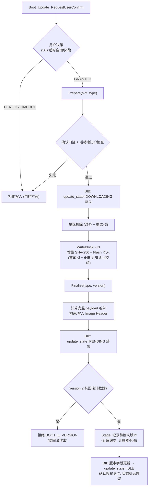

### 7.3 SBL 集成层启动链路 (sbl_main_boot)

```
① Boot_AntiRollback_Read → 装载最新计数器 (0 = 禁用抗回滚)
② 填入 bl_secure_boot_config.anti_rollback_counter
③ sbl_main_connect_antrollback: 注入存储接口 → Boot_Update
   (同步 confirm_boots 阈值与健康门控状态)
④ bl_secure_boot_verify(App 固件)
⑤a 通过: 门控关 → NotifySuccessfulBoot (延后递增提交)
         门控开 → 记 boot_attempt, 等 App 健康确认
         → jump_to_app (生产: Boot_Loader_Jump, noreturn)
⑤c 失败: 记录 BL_BOOT_RESULT_FAILURE
         → 自动回滚使能且需要 → bl_rollback_execute(SIGNATURE_INVALID)
         → 否则 enter_recovery (生产: Boot_Loader_EnterRecovery)
```

**启动结果枚举** (审计上报): `APP_STARTED` / `APP_REJECTED` / `ROLLBACK` / `RECOVERY`。

---

## 8. 回滚与 A/B 分区

### 8.1 自动回滚 (bl_rollback)

- **触发条件:** 连续启动失败 ≥ 阈值 (默认 2)、boot_attempt 超限 (默认 3)、验签失败、看门狗超时、安全违规、用户请求、OTA 超时、Flash 错误。
- **版本历史:** 保留最近 4 个版本 (版本号/分区/哈希/安装时间/启动统计), 持久化记录带 CRC (magic `'ROLB'`)。
- **执行:** 选择最近有效历史版本 → 分区切换 (更新 BIB 槽位 marker) → 验证 → 确认; 全程状态机 IDLE→CHECKING→PREPARING→EXECUTING→VERIFYING→COMPLETED/FAILED。
- **DEM 集成:** 回滚事件经 `report_dtc` 回调上报 DTC。

**Mermaid 状态机:**

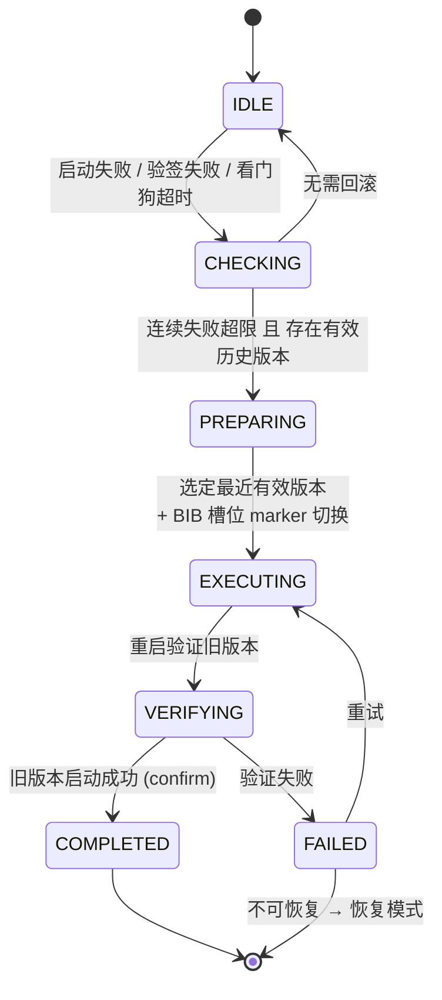

### 8.2 A/B 分区管理 (bl_partition)

- **分区表** (magic `'PART'`, CRC32 保护): 最多 4 个分区 (bootloader / app A/B / 标定 / 配置 / OTA 元数据), 记录地址/版本/哈希/签名/启动统计/OTA 进度。
- **状态机:** INACTIVE → UPDATING → UPDATE_PENDING → ACTIVE; 异常 → UNBOOTABLE / ROLLBACK。
- **切换:** `bl_partition_switch_active("app_b")` → 应用启动成功后 `bl_partition_commit_switch()` 确认; 支持切换/回滚事件回调。
- **Flash 驱动抽象:** `bl_flash_driver_t` 函数表 (init/read/erase/program/verify/get_info/unlock/lock), 平台注入。

**Mermaid 分区状态机:**

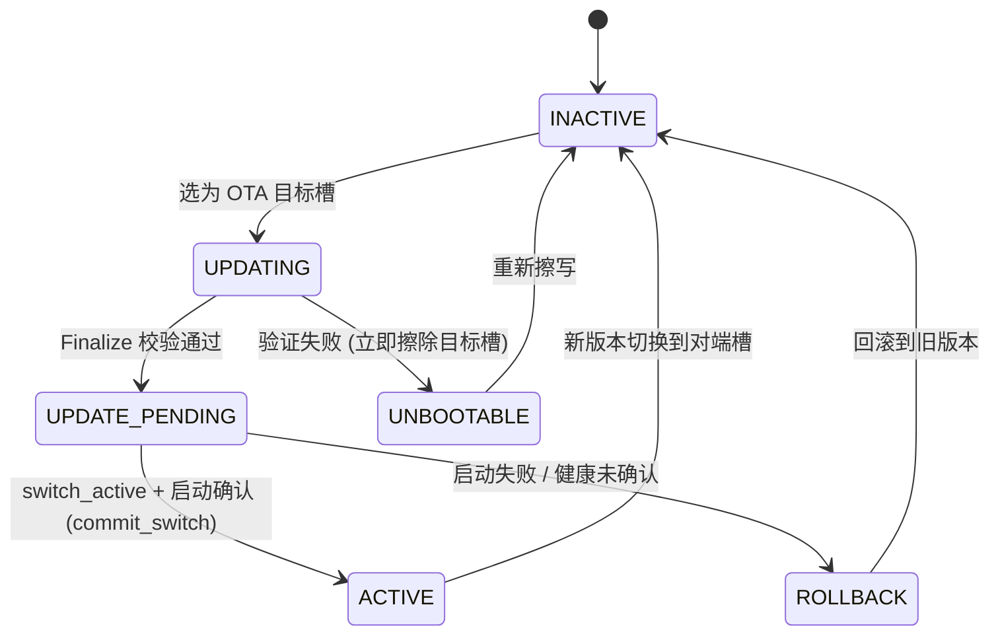

---

## 9. 模块接口摘要

### 9.1 bsw/boot 静态库

| 模块 | 关键 API | 说明 |
|:-----|:---------|:-----|
| Boot_Loader | `Boot_Loader_Main` / `Jump` / `EnterRecovery` / `ResolveBootTarget` / `ConfirmBoot` | 启动主流程/跳转/恢复 |
| Boot_Handshake | `GetTarget` / `SetTarget` / `Clear` | App↔Bootloader 跨复位握手 (共享头 `Boot_Handshake.h`) |
| Boot_Update | `Prepare` / `WriteBlock` / `Finalize` / `Abort` / `SwapSlots`; `RequestUserConfirm` / `ConfirmUserDecision` / `GetConfirmState` / `SetTimeSource`; `NotifyBootSuccess` / `GetRollbackCounter` / `SetRollbackConfirmBoots` / `SetHealthCheckMode` / `ConfirmBusinessHealth` / `SetAntiRollbackStorage` | UDS 更新 + 用户确认 + 抗回滚延后递增 |
| Boot_Image | `ValidateHeader` / `VerifyHash` / `ReadTrailer` / `CalcHeaderCrc` | 映像头/尾处理 |
| Boot_Verify | `VerifySignature` / `Hash` / `ConstantCmp`; `g_boot_pubkey_sbl/app` | 软件验签 (mbedtls) |
| Boot_Flash | `Init` / `Erase` / `Write` / `Read` / `SetProtection` | Flash HAL (重试×3 + 读回校验) |
| Boot_Hsm | `Init` / `VerifySignature` / `Random` / `IsAvailable` | HSM HAL (验签/TRNG) |

**统一错误码 (Boot_Result):** `OK=0x00`, 参数/初始化 `0x01-0x02`, 验签类 `0x10-0x13` (SIGNATURE/HASH/VERSION/HEADER_CRC), Flash 类 `0x20-0x23`, HSM 类 `0x30-0x31`, `TIMEOUT=0x40`, 确认类 `0x50-0x51` (PENDING/DENIED), `GENERAL=0xFF`。

### 9.2 bootloader OTA 服务层

| 模块 | 职责 | 关键 API |
|:-----|:-----|:---------|
| bl_partition | A/B 分区表/状态/Flash 操作 | `init` / `get_active_app` / `get_ota_target` / `switch_active` / `commit_switch` / `read/erase/program/verify_crc` |
| bl_secure_boot | 固件验签/证书链/防回滚 | `init` / `verify` / `verify_fast` / `verify_strict` (3步) / `check_rollback` / `parse_cert_chain` / `lock_version` |
| bl_rollback | 自动回滚/版本历史 | `record_install` / `record_boot_attempt/result` / `check_needed` / `execute` / `confirm` / `get_previous_version` |
| bl_antrollback | 单调计数器 NVM (磨损均衡) | `Init` / `Read` / `Write` / `Increment` / `Stage` / `NotifySuccessfulBoot` / `SetConfirmBoots` / `SetHealthCheckMode` / `ConfirmHealth` / `GetStorageApi` |
| bl_upgrade_log | 升级审计环形日志 | `Write` / `Read` / `GetCount` / `Save` / `Load` |
| bl_time | 时间源抽象 | `set_provider` / `get_ms` |
| sbl_main | 集成层 | `init` / `boot` / `load_rollback_counter` / `connect_antrollback` |

---

## 10. 配置参数 (Boot_Cfg.h)

由 yuleASR-Configurator (OtaSecurity 容器) 生成:

| 参数 | 默认值 | 说明 |
|:-----|:-------|:-----|
| `BOOT_WDG_TIMEOUT_MS` | 5000 | 看门狗超时 |
| `BOOT_VERIFY_TIMEOUT_MS` | 10000 | 验签超时 |
| `BOOT_USER_CONFIRM_TIMEOUT_MS` | 30000 | 用户确认超时 (0=不超时) |
| `BOOT_MAX_RETRIES` | 3 | Flash 操作重试次数 |
| `BOOT_MAX_BOOT_ATTEMPTS` | 5 | 最大启动尝试 (超限进恢复) |
| `BOOT_ROLLBACK_CONFIRM_BOOTS` | 3 | 抗回滚延后递增阈值 N |
| `BOOT_SECURE_BOOT_ENABLE` | ON | 安全启动总开关 |
| `BOOT_SIGNATURE_ALGORITHM` | ECDSA_P256 | 签名算法 |
| `BOOT_ANTI_ROLLBACK_ENABLE` | ON | 抗回滚开关 |
| `BOOT_USER_CONFIRM_REQUIRED` | ON | 用户确认门控开关 |
| `BOOT_CERT_CHAIN_MAX_DEPTH` | 4 | 证书链最大深度 |
| `BOOT_UPGRADE_LOG_ENABLE` / `_MAX_ENTRIES` | ON / 16 | 升级日志开关/容量 |
| `BOOT_HSM_KEY_SLOT_PBL/SBL/APP` | 0/1/2 | HSM 密钥槽 |
| `BOOT_DEBUG_ENABLE` | 0 | 调试跟踪 (经 SchM_Log) |

---

## 11. 错误处理与 fail-closed 原则

1. **验签失败即拒绝**: 任何一步 (签名/版本绑定/哈希/计数器) 失败 → 不启动, 走回滚或恢复模式; 验证失败立即擦除目标槽。
2. **无后端不降级**: SM2/SM3 显式返回 NOT_SUPPORTED, 绝不回落 SHA-256/ECDSA。
3. **无时间源不静默**: 证书有效期校验/审计时间戳必须显式报错 (`TIME_UNAVAILABLE`), 禁止 0 时间戳"恒真"。
4. **NVM 不可用拒绝完成升级**: Finalize 阶段读计数器失败 → `BOOT_E_GENERAL` (fail-closed)。
5. **BIB/槽位/日志全部 CRC 保护**: 损坏即重建 (BIB) / 跳过 (抗回滚槽位) / 报错 (日志条目)。
6. **计数器只增不减**: 低于地板的写入/版本 → `DECREMENT_ATTEMPT` / `BOOT_E_VERSION`。

---

## 12. 可移植性设计 (Porting Points)

| 抽象层 | 平台相关代码 | 通用代码 | 新平台移植工作量 |
|:-------|:-------------|:---------|:----------------|
| Boot_Flash | `Flash_EraseSector/Write/Read` (MCAL Flash) | 对齐/重试/读回校验 | 替换 3 个函数 |
| Boot_Hsm | `S32K312_Hsm_Init` / `Crypto_HwTrng_Generate` / ECC verify | 密钥槽管理/可用性缓存 | 替换 4 个函数 |
| Boot_Verify | (纯软件, mbedtls) | ECDSA + SHA-256 | 0, 直接复用 |
| Boot_Loader | 启动地址/栈宏 | 状态机/跳转逻辑 | 替换 2 个宏 |
| bl_* 服务层 | flash 驱动函数表注入 | 全部逻辑 | 注入真实驱动即可 |

**生产替换清单 (当前为骨架/stub):**
- `Boot_Verify.c` 中 DER 公钥占位符 → 真实密钥
- `Boot_Hsm.c` 验签 stub (恒返回 `E_HSM_VERIFY`) → `S32K312_Hsm_EccVerify`
- `Boot_Flash.c` `SetProtection` 空实现 → CSEc 驱动
- `sbl_main` 配置回调 (jump_to_app/enter_recovery/on_boot_result) → `Boot_Loader_Jump/EnterRecovery`/升级日志
- `Boot_Loader_EnterRecovery` 死循环 → CAN/DoIP UDS 诊断刷写循环

---

## 13. 合规矩阵

| 需求标记 | 法规/标准条款 | 实现 |
|:---------|:-------------|:-----|
| RS-OTA-01 | UNECE R156 防回滚 | bl_antrollback 单调计数器 + 延后递增 (P1-4) |
| RS-OTA-02 | GB 44496-2024 §6.3 用户告知确认 | Boot_Update 用户确认状态机 (30s 超时) |
| RS-OTA-03 | GB 44496-2024 §7.2 / R156 §7.1.1 SUMS 可追溯 | bl_upgrade_log 环形审计日志 (CRC/NVM) |
| RS-OTA-04 | ISO/SAE 21434 防篡改 | 3 步验签 + 版本绑定签名 |
| RS-OTA-05 | 升级后功能健康 | 业务健康门控 (ASW 确认后提交计数器) |
| RS-OTA-06 | 刷写掉电安全 | BIB update_state 三态掉电保护 |
| — | UNECE R156 / ISO 21434 / ASIL-D | 全模块标注, 信任链 + 防降级 + fail-closed |

---

## 14. 测试资产

| 测试 | 位置 | 覆盖 |
|:-----|:-----|:-----|
| 映像/验签/集成单测 | [src/bsw/boot/test](file:///workspace/src/bsw/boot/test) | test_boot_image / test_boot_verify / test_boot_integration / test_boot_update_confirm (用户确认) |
| OTA 服务层单测 | [src/bootloader/tests](file:///workspace/src/bootloader/tests) | test_bootloader (含 SM2/SM3 fail-closed) / test_sbl_main (集成链路) / test_e2e_antrollback (抗回滚端到端) |

宿主构建即可运行 (x86 CI): flash/CSM/跳转均可 mock 注入, 无真实硬件依赖。

---

## 15. 已知限制与后续路线

1. **SM2/SM3 国密** — 就绪框架已落地 (枚举/fail-closed/测试覆盖), 待引入 GmSSL 或 SM 版 HSM 固件后实装 (路径见 [README](file:///workspace/src/bootloader/README.md) §国密支持状态)。
2. **HSM 验签/Flash 写保护** — 当前 stub, 待 S32K312 CSEc/HSM 驱动头文件清理后接线。
3. **恢复模式** — 当前骨架, 生产需实现 CAN/DoIP UDS 刷写循环。
4. **mbedtls 增量哈希** — `MBEDTLS_USE` 编译开关切换增量/全量路径; 非 mbedtls 路径已修复为流式哈希 (防旧实现 256B 缓冲越界读)。
5. **v1 抗回滚记录不兼容** — v1→v3 属预期格式变更, 升级后首次初始化从 0 开始 (见 `BL_ANTIROLLBACK_RECORD_VERSION`)。
6. **握手冷启动判定需按芯片 RM 复核** — `Boot_Handshake_IsColdStart()` 沿用项目 `Cdd_Boot` 的简化 RGM 模型 (`DES==0 && FES==0` → POR); 对接真实 S32K312 时需按 RM 复核 RGM_DES/FES 位定义, 并确认 brown-out (BOR) 是否一并纳入冷启动条件 (BOR 同样可能使 SRAM 内容不可信)。另: App/SBL 用 `s32k312.ld` 与 PBL 用 `Boot_Linker.ld` 的 `ram_handshake ORIGIN` 一致性目前靠注释+ASSERT 约定, 如新增镜像须同步维护。

---

*本文档提炼自 yuleASR 工程源码与既有设计文档 ([secure-boot-architecture.md](file:///workspace/docs/design/secure-boot-architecture.md)、[boot-dcm-integration.md](file:///workspace/docs/design/boot-dcm-integration.md)), 与代码实现保持一致。*
